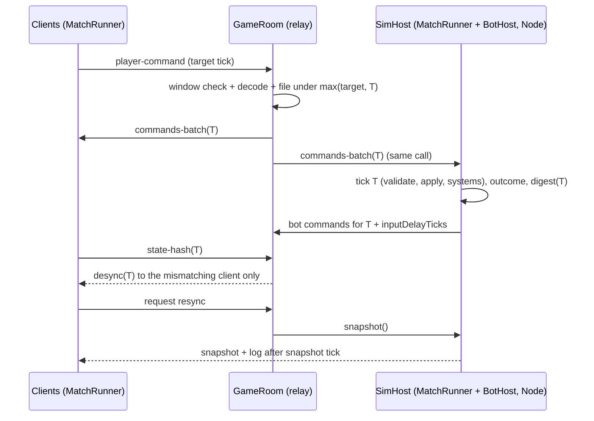

# Server-side simulation (engine 0.3)

Status: design approved 2026-10-14; contracts in `@phalanx-engine/runtime`
(skeleton, Task 1). Implementation follows Tasks 2–13
(see [runtime-api.md § Task map](./runtime-api.md#task-map)).

**Task 11 as shipped.** The prompt (rev 17.10) requires one
`worker_threads` sim (or `inProcess` for tests), serializable messages, and
a relay that does not block on the sim. This document's §4 and §6 describe
a synchronous in-process sim and drop workers until a later task. The code
follows the prompt: `PhalanxConfig.games` plus `simHost.mode`
`'worker' | 'inProcess'`, one worker, private rooms opt in with
`matchConfig`, and bot commands return to the relay to be stamped. A real
worker death ends every server match on that worker. Practice rooms and
matchmaking auto-fill are not in this change. Per-tick cost was not
measured.

Related: [runtime-api.md](./runtime-api.md) (contracts and review),
[reconnect.md](./reconnect.md).

## 1. Goal

Phalanx stays a deterministic lockstep engine. Engine 0.3 adds an **opt-in**
mode in which the server is an additional lockstep **peer**:

- it stamps the command stream (as today);
- it runs the same simulation headlessly in Node;
- it injects **server bot** commands into the stream;
- it arbitrates state hashes;
- it serves **on-demand snapshots** for reconnect and resync.

Clients still simulate locally. There is **no state streaming**: only
commands cross the wire. Without games configured, `phalanx-server` stays a
pure relay, exactly as today.

## 2. Layers

- **Game package** (e.g. `sketch-legion`), in two parts:
  - `src/sim`: the `GameDefinition` (world, commands, `GameState`, bots,
    outcome). It MUST NOT import the renderer or the DOM, because the server
    runs it.
  - `src/view`: renderer, UI and input. Client only.
- **`@phalanx-engine/runtime`** (new, isomorphic, no DOM, no sockets):
  - `defineGame` / `GameDefinition`, `MatchConfigBase` / `SlotConfig` /
    `simMode`;
  - `GameState` / `GameStateSpec` / `StateWriter` / `StateReader`, plus the
    optional `StateHelpers`;
  - `MatchRunner`: the tick loop, the command log with decode/validate, the
    digest, `snapshot` / `restore` (header, digest, version policy) and
    `fastForward` catch-up;
  - `BotHost`: runs the `BotPolicy` of the bot slots hosted on this side;
  - `WorldScope`: isolates the process-global ecs registers per world;
  - the `Transport` interface and `LocalTransport` (optional `MatchStore`);
  - replay records, `MatchStore`, `MemoryMatchStore` and
    `IndexedDbMatchStore` (Task 7; IndexedDB is `globalThis.indexedDB`,
    not a DOM import).
- **`@phalanx-engine/ecs`, `abilities`, `physics`, `math`:** unchanged except
  for small additive hooks (Task 3):
  - entity id counter accessors and `SoAComponent.currentEntityManager()`;
  - `DeterministicRandom` moved into `math`, with state export/import;
  - an `InstanceIdCounter` setter and a GAS runtime state accessor;
  - pool state accessors;
  - a public broadphase rebuild.
- **`@phalanx-engine/client`:** `PhalanxClient` unchanged. It adds
  `ServerPeerTransport` (Task 12), `RelayLockstepTransport` (later) and the
  session storage. `IndexedDbMatchStore` is runtime (Task 7), not client.
  It **re-exports `MatchRunner`, `LocalTransport` and `defineGame`**, so a game
  can import the runner from the client.
- **`@phalanx-engine/server`:** the relay (`GameRoom`, `PrivateRoomService`)
  is unchanged. It adds `SimHost` (one `MatchRunner` per server-mode match,
  Task 11), bot slots in rooms and an in-memory snapshot store (Redis later).

Dependency direction: `math ← ecs ← runtime ← client / server`. The runtime
never depends on the client or the server.

## 3. Modes

The mode is chosen per match by `MatchConfigBase.simMode`.

|                | `client`                                       | `server`                                                          |
| -------------- | ---------------------------------------------- | ----------------------------------------------------------------- |
| Who simulates  | each client                                    | each client **and** the server (peer)                             |
| Ticks/commands | `LocalTransport` (offline) or relay lockstep   | the server stamps; human and server-bot commands share one stream |
| Bots           | local slots (`runsOn: 'local'`)                | server slots (`runsOn: 'server'`); clients never run them         |
| Hash           | clients compare; a mismatch **ends the match** | the server is the arbiter; a mismatch **resyncs that client**     |
| Reconnect      | local snapshot (every 300 ticks) + log tail    | **fresh server snapshot on request** + ticks in flight            |
| Traffic        | commands only                                  | commands only (no state streaming)                                |

Online 1v1 for the first game (Sketch Legion) uses server mode directly.

## 4. Server-mode tick

Per server tick T, inside `GameRoom.processTick`
(`phalanx-server/src/services/GameRoom.ts:634`):

1. Clients have sent `player-command` for some target tick. `GameRoom`
   checks the window (`maxTickBehind` / `maxTickAhead`), pre-filters the
   payload with `CommandSchema.decode` (structural only, Task 11) and files
   the command under `max(targetTick, currentTick)`
   (`GameRoom.ts:699`).
2. `GameRoom` broadcasts `commands-batch(T)` to the clients and hands the
   same batch to `SimHost`.
3. `SimHost` runs tick T **synchronously** in the same call: decode,
   validate, `applyCommand`, then the tick systems.
4. Right after tick T, the server bots `decide(sim, T)`. Their commands are
   filed directly into `pendingCommands[T + inputDelayTicks]`, keyed by
   `bot:<slot>`. Bot commands bypass `handleCommand`; validation happens
   in-sim on every peer.
5. Every `hashEveryTicks` the server computes `digest(T)` from its own
   `GameState.save()` bytes.
6. Clients send `state-hash(T)`. Each client is compared **against the
   server**, not against the other clients. A mismatching client receives
   `desync` and resyncs from a fresh snapshot; the match continues. Relay
   mode is unchanged: `GameRoom.receiveStateHash` still ends the match.
   Task 11 must not apply the resync policy there.



Because the server sim runs inside `processTick`, it can never lag behind
the stamped stream. That changes only once matches move to `worker_threads`
(a later task), which then needs a bounded queue per match.

## 5. Multiple matches in one process

`SimHost` runs many `MatchRunner`s in one Node process. Two pieces of
phalanx-ecs state are process-global today:

- the entity id counter (`phalanx-ecs/src/Entity.ts:3`), which `GameWorld`
  resets in its constructor (`GameWorld.ts:156`);
- the `SoAComponent` EntityManager context (`SoAComponent.ts:51`, set by
  `GameWorld.ts:162`).

Without isolation, creating match B resets and steals the context of
match A. The runtime therefore wraps every entry into a world in
`WorldScope.run` (see [runtime-api.md § Review, finding 4](./runtime-api.md#review--corrections)).
Simulation code must never `await` inside a tick, which lockstep already
requires.

## 6. Server configuration (additive)

The real entry point is `new Phalanx(config?: Partial<PhalanxConfig>)`
(`phalanx-server/src/Phalanx.ts:61`). There is no `createPhalanxServer`. The
additive fields (Task 11):

```ts
interface PhalanxConfig {
  // ...existing fields unchanged...
  /** No games → pure relay, exactly as today. */
  games?: readonly AnyGameDefinition[];
  simHost?: {
    /** Default DEFAULT_SERVER_SNAPSHOT_EVERY_TICKS (1000). */
    snapshotEveryTicks?: number;
    /** Reject new server-mode matches beyond this many. */
    maxMatches?: number;
    /** Build the MatchConfig of a room (slots, teams, bots, game extras). */
    resolveMatchConfig?: (room: ServerRoomInfo) => MatchConfigBase;
  };
}
```

`GameDefinition.id` is the server `gameTypes[].gameType`. At startup the
server MUST check, for each game, that the resolved `GameTypeConfig.tickRate`
equals `GameDefinition.tickRate` and that `tickMode` is continuous, and throw
otherwise.

## 7. Load estimates (estimates, to be measured)

- Bench basis: the server Xeon at 240 bodies took ≈ 31 ms/tick before
  spatial-grid targeting; after it, ~10–12 ms peak and 5–8 ms average.
- CPU per match at 10 Hz:
  - 1v1 (240 bodies): 5–8 % average, 12 % peak of a core;
  - 2v2 (400–480 bodies): 10–15 % average, 25 % peak;
  - 3v3 (600–720 bodies): 15–25 % average, 40 % peak.
- Bots cost < 1 %. Memory is 20–100 MB per match.
- Render Standard (1 CPU) fits about 8–12 1v1, 4–6 2v2 or 3–4 3v3 matches.
  Pro (2 CPU) needs a `worker_threads` pool (a later task).
- Snapshot cost on the server is one `GameState.save()` per request, plus
  one every 1000 ticks for persistence.

These numbers are estimates from one game's bench; Task 11 must measure the
real per-tick cost under `SimHost` and record it here.

## 8. Practice and bot auto-fill (Sketch Legion)

Decided 2026-10-14. Two ways into a human-vs-server-bot match, both
`simMode: 'server'`:

- **Practice / training.** A dedicated entry starts immediately: the human
  plus server bot slots from `resolveMatchConfig`. No queue.
- **Matchmaking auto-fill.** The queue waits for a live opponent. If none
  arrives within a timeout, the empty slots are filled with server bots
  (the Lands / Chapaev behaviour) and the match starts.

Private rooms stay two humans. Task 11 adds both paths; the timeout value
is game config, not an engine constant. A process restart still drops the
queue and any in-memory match ("no result"); Redis is out of 0.3.
