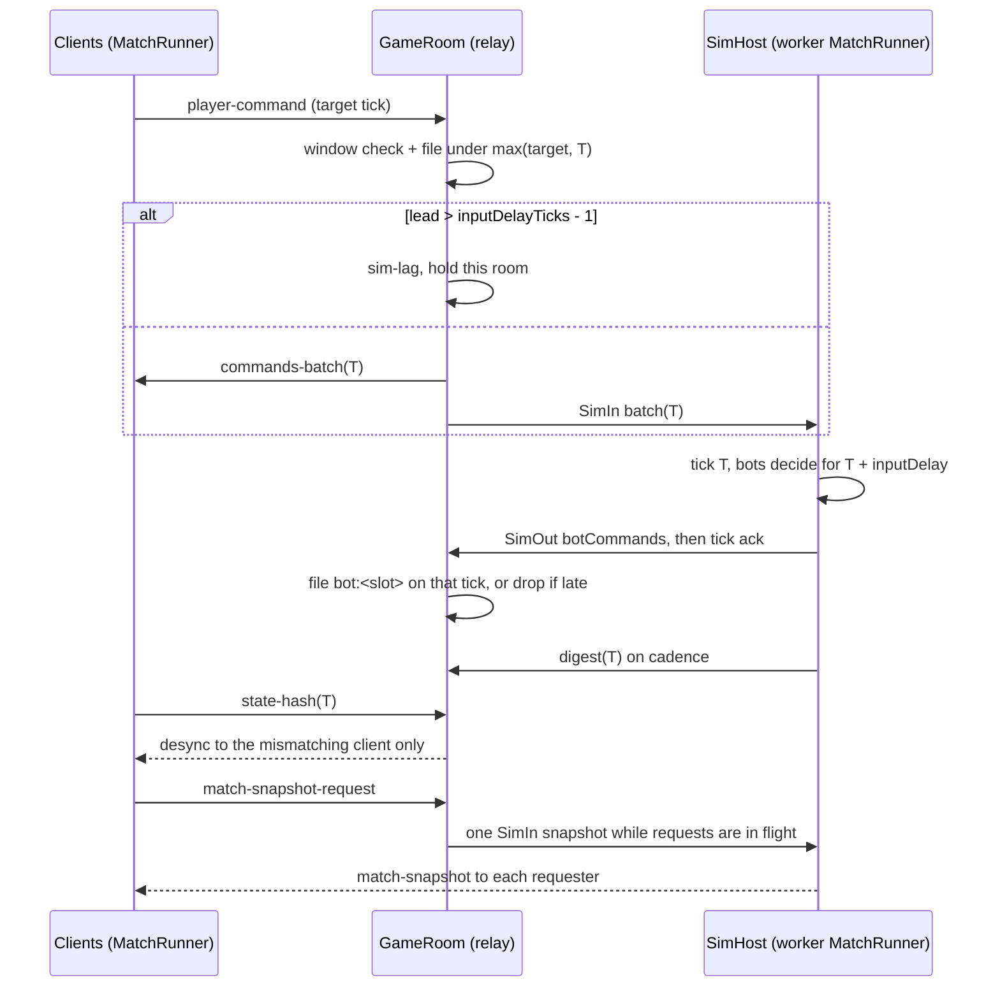

# Server-side simulation (engine 0.3)

Status: design approved 2026-10-14; contracts in `@phalanx-engine/runtime`
(skeleton, Task 1). Implementation follows Tasks 2–13
(see [runtime-api.md § Task map](./runtime-api.md#task-map)).

**Task 11 as shipped.** One `worker_threads` sim (or `inProcess` for
tests) runs beside the relay. The relay stamps and broadcasts without
waiting on the sim. Private rooms opt in with `matchConfig`. Bot commands
return to the relay and target `S + inputDelayTicks`. A room whose lead
exceeds `inputDelayTicks - 1` pauses its own tick loop (`sim-lag`); other
rooms do not. A real worker death ends every server match on that worker
and is not restarted here (Task 17). Practice rooms, matchmaking
auto-fill, and a per-tick cost measurement are not in this change. The
relay↔sim messages are `SimIn` / `SimOut` (`batch`, `botCommands`,
`digest`, `tick`, `snapshot`, …), which are not the socket event names
(`commands-batch`, `state-hash`, `match-snapshot`).

Related: [runtime-api.md](./runtime-api.md) (contracts and review),
[reconnect.md](./reconnect.md).

## 1. Goal

Phalanx stays a deterministic lockstep engine. Engine 0.3 adds an **opt-in**
mode in which the server is an additional lockstep **peer**:

- it stamps the command stream (as today);
- it runs the same simulation headlessly in Node;
- it injects **server bot** commands into the stream;
- it arbitrates state hashes;
- it serves **on-demand snapshots** for reconnect and resync.

Clients still simulate locally. There is **no state streaming**: only
commands cross the wire. Without games configured, `phalanx-server` stays a
pure relay, exactly as today.

## 2. Layers

- **Game package** (e.g. `sketch-legion`), in two parts:
  - `src/sim`: the `GameDefinition` (world, commands, `GameState`, bots,
    outcome). It MUST NOT import the renderer or the DOM, because the server
    runs it.
  - `src/view`: renderer, UI and input. Client only.
- **`@phalanx-engine/runtime`** (new, isomorphic, no DOM, no sockets):
  - `defineGame` / `GameDefinition`, `MatchConfigBase` / `SlotConfig` /
    `simMode`;
  - `GameState` / `GameStateSpec` / `StateWriter` / `StateReader`, plus the
    optional `StateHelpers`;
  - `MatchRunner`: the tick loop, the command log with decode/validate, the
    digest, `snapshot` / `restore` (header, digest, version policy) and
    `fastForward` catch-up;
  - `BotHost`: runs the `BotPolicy` of the bot slots hosted on this side;
  - `WorldScope`: isolates the process-global ecs registers per world;
  - the `Transport` interface and `LocalTransport` (optional `MatchStore`);
  - replay records, `MatchStore`, `MemoryMatchStore` and
    `IndexedDbMatchStore` (Task 7; IndexedDB is `globalThis.indexedDB`,
    not a DOM import).
- **`@phalanx-engine/ecs`, `abilities`, `physics`, `math`:** unchanged except
  for small additive hooks (Task 3):
  - entity id counter accessors and `SoAComponent.currentEntityManager()`;
  - `DeterministicRandom` moved into `math`, with state export/import;
  - an `InstanceIdCounter` setter and a GAS runtime state accessor;
  - pool state accessors;
  - a public broadphase rebuild.
- **`@phalanx-engine/client`:** `PhalanxClient` unchanged. It adds
  `ServerPeerTransport` (Task 12), `RelayLockstepTransport` (later) and the
  session storage. `IndexedDbMatchStore` is runtime (Task 7), not client.
  It **re-exports `MatchRunner`, `LocalTransport` and `defineGame`**, so a game
  can import the runner from the client.
- **`@phalanx-engine/server`:** the relay (`GameRoom`, `PrivateRoomService`)
  is unchanged. It adds `SimHost` (one `MatchRunner` per server-mode match,
  Task 11), bot slots in rooms and an in-memory snapshot store (Redis later).

Dependency direction: `math ← ecs ← runtime ← client / server`. The runtime
never depends on the client or the server.

## 3. Modes

The mode is chosen per match by `MatchConfigBase.simMode`.

|                | `client`                                       | `server`                                                          |
| -------------- | ---------------------------------------------- | ----------------------------------------------------------------- |
| Who simulates  | each client                                    | each client **and** the server (peer)                             |
| Ticks/commands | `LocalTransport` (offline) or relay lockstep   | the server stamps; human and server-bot commands share one stream |
| Bots           | local slots (`runsOn: 'local'`)                | server slots (`runsOn: 'server'`); clients never run them         |
| Hash           | clients compare; a mismatch **ends the match** | the server is the arbiter; a mismatch **resyncs that client**     |
| Reconnect      | local snapshot (every 300 ticks) + log tail    | **fresh server snapshot on request** + ticks in flight            |
| Traffic        | commands only                                  | commands only (no state streaming)                                |

Online 1v1 for the first game (Sketch Legion) uses server mode directly.

## 4. Server-mode tick

The sim does **not** run inside `GameRoom.processTick`. The relay and the
sim are peers on one command log. The relay is the only stamper. The sim
(one worker, or the in-process queue) consumes `SimIn` and replies with
`SimOut`.

Per relay tick T, in `GameRoom.processTick`:

1. Clients have sent `player-command` for some target tick. `GameRoom`
   checks the window (`maxTickBehind` / `maxTickAhead`). On a server match
   it also pre-filters the payload with `commands.decode`. Human commands
   are filed under `max(targetTick, currentTick)`.
2. If this room's lead over the sim exceeds `inputDelayTicks - 1`,
   `processTick` does **not** broadcast. It emits `sim-lag` and holds
   **this room's** clock. Other rooms, including relay-only rooms, keep
   ticking. The next attempt is `setTimeout(1000/tickRate)` then
   `setImmediate`, so a sim reply already queued is applied before the
   next broadcast.
3. Otherwise `GameRoom` broadcasts `commands-batch(T)` and posts
   `SimIn { t: 'batch', tick: T }` with that same batch. It does not wait
   for the sim.
4. The sim runs tick T on its thread: decode, validate, apply, systems.
   Then bots `decide(sim, T)` and the sim sends `botCommands` for
   `T + inputDelayTicks`, player id `bot:<slot>`, then a `tick` ack.
   The relay files those bot commands on the tick the sim chose. A bot
   command whose tick was already broadcast is `bot-commands-late` and
   dropped, not moved forward. When the ack brings the lead back under
   the bound, the held room broadcasts again.
5. Every `hashEveryTicks` (60) the sim sends `digest(T)`. A client
   `state-hash` for an off-cadence tick, or for a tick further than
   `currentTick + maxTickAhead`, is ignored. Hashes that arrive before
   the digest wait in a capped queue. Each client is compared **against
   the server**. The first mismatch sends `desync { playerId, tick }` to
   that player only; the match continues. A later hash from the same
   player is not reported again. Relay rooms with no server sim are
   unchanged: `receiveStateHash` still ends the match when
   `enableStateHashing` is on.
6. Snapshots: every `snapshotEveryTicks` (default 1000, tick 0 excluded)
   and on `match-snapshot-request`. Each player has one pending request;
   a newer id replaces the previous one, and those waiters share one
   `snapshot()` call. A player is answered at most once a second, from
   the store or from a new sim snapshot. A request inside that interval
   is kept (the latest id wins) and answered when it elapses. The bytes
   go only to the sockets that asked,
   each with its own `requestId`. A request id is per player, so two
   players can both use `1`.



The sim can fall behind the relay. The per-room hold is what keeps bot
commands on the tick they were chosen for. A dead worker
(`ERR_WORKER_OUT_OF_MEMORY` or a thread exit) fails every server match on
that worker. A later `room-create` gets `room-error` with reason
`sim-unavailable` and does not start. A thrown tick is `sim-error` for
that match only. `process.exit` inside a match is `sim-crash` for that
match; a normal host `close` is not.

`system` commands are produced only by `RoomSim`. The relay rejects player
ids `system` and `bot:<slot>` on `queue-join`, `room-create`, `room-join`,
and `room-recover`, and rejects them on a human `matchConfig` slot. A
client `player-command` is stamped with the socket's player id, so the
body cannot file `system`. `MatchRunner` applies a `system` entry from a
`commands-batch` only when the match has a server peer (`side: 'server'`
or transport kind `server-peer`). A relay or local client rejects it. Bot
auto-ready follows slot `kind`, not the id string. Private-room
`matchConfig` is the only 0.3 way into a server match. Practice rooms and
matchmaking bot auto-fill are a later task. A dead worker is not respawned
until Task 17.

## 5. Multiple matches in one process

`SimHost` runs many `MatchRunner`s in one Node process. Two pieces of
phalanx-ecs state are process-global today:

- the entity id counter (`phalanx-ecs/src/Entity.ts:3`), which `GameWorld`
  resets in its constructor (`GameWorld.ts:156`);
- the `SoAComponent` EntityManager context (`SoAComponent.ts:51`, set by
  `GameWorld.ts:162`).

Without isolation, creating match B resets and steals the context of
match A. The runtime therefore wraps every entry into a world in
`WorldScope.run` (see [runtime-api.md § Review, finding 4](./runtime-api.md#review--corrections)).
Simulation code must never `await` inside a tick, which lockstep already
requires.

## 6. Server configuration (additive)

The entry point is `new Phalanx(config?: Partial<PhalanxConfig>)`. There is
no `createPhalanxServer`. The Task 11 fields:

```ts
import { createServerSim } from '@phalanx-engine/runtime/server';

new Phalanx({
  sim: createServerSim({
    games: [{ module: './myGame.js' }],
    snapshotEveryTicks: 1000,
  }),
});
```

`PhalanxConfig.sim` is a `ServerSimHook`. Omit it and the process stays a
pure relay: no worker is spawned. `createServerSim` takes the game list
and host options (`mode`, `workers`, `resourceLimits`, `snapshotEveryTicks`,
`maxMatches`). Default mode is one worker. `workers` is reserved until
Task 17; only `1` is accepted. `snapshotEveryTicks` defaults to 1000.
`maxMatches` caps concurrent server matches. The count is reserved when
the room is created (including a room still waiting for humans) and
released on cancel, expiry, or when the live match ends.

A worker loads each game by module path (`GameModuleSpec`). An in-process
host may also take a `GameDefinition` object. `configKeys` is the allow-list
of integer `matchConfig` fields copied into the runner config. Any other
extra key is rejected. The server fills `matchId`, `seed`, `side`,
`simVersion`, and `inputDelayTicks`; those cannot be client extras.

`room-create` opts in with `matchConfig: { gameId, simMode: 'server', slots,
inputDelayTicks?, absencePolicy? }`. Omitted `matchConfig` stays the
two-human relay room. `GameDefinition.id` is the `gameId`. At startup the
server checks that each game's `tickRate` equals the resolved server
`tickRate` and that `tickMode` is continuous, and throws otherwise.

Slots come from
`matchConfig`. Practice rooms and matchmaking auto-fill are not in this
change.

## 7. Load estimates (estimates, to be measured)

- Bench basis: the server Xeon at 240 bodies took ≈ 31 ms/tick before
  spatial-grid targeting; after it, ~10–12 ms peak and 5–8 ms average.
- CPU per match at 10 Hz:
  - 1v1 (240 bodies): 5–8 % average, 12 % peak of a core;
  - 2v2 (400–480 bodies): 10–15 % average, 25 % peak;
  - 3v3 (600–720 bodies): 15–25 % average, 40 % peak.
- Bots cost < 1 %. Memory is 20–100 MB per match.
- Render Standard (1 CPU) fits about 8–12 1v1, 4–6 2v2 or 3–4 3v3 matches.
  Pro (2 CPU) needs a `worker_threads` pool (a later task).
- Snapshot cost on the server is one `GameState.save()` per request, plus
  one every 1000 ticks for persistence.

These numbers are estimates from one game's bench; Task 11 must measure the
real per-tick cost under `SimHost` and record it here.

## 8. Practice and bot auto-fill (Sketch Legion)

Decided 2026-10-14. Two ways into a human-vs-server-bot match, both
`simMode: 'server'`:

- **Practice / training.** A dedicated entry starts immediately: the human
  plus server bot slots from `resolveMatchConfig`. No queue.
- **Matchmaking auto-fill.** The queue waits for a live opponent. If none
  arrives within a timeout, the empty slots are filled with server bots
  (the Lands / Chapaev behaviour) and the match starts.

Private-room `matchConfig` is the only 0.3 entry. Practice rooms and
matchmaking bot auto-fill are a later task; `resolveMatchConfig` is not
implemented. A process restart still drops the queue and any in-memory
match ("no result"); Redis is out of 0.3.
